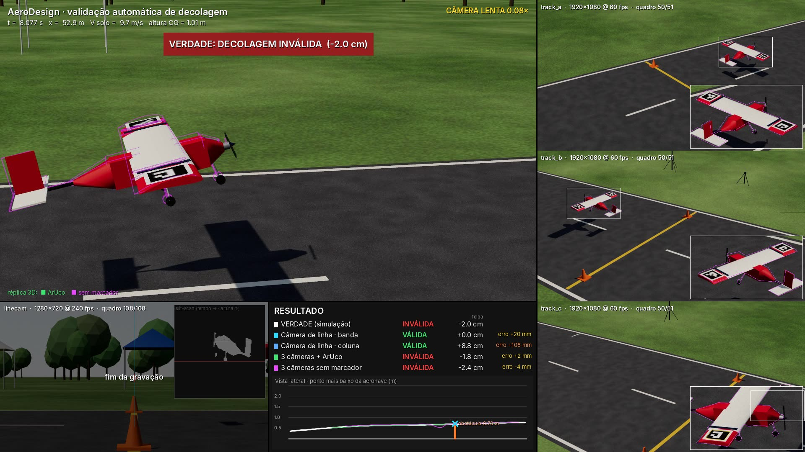
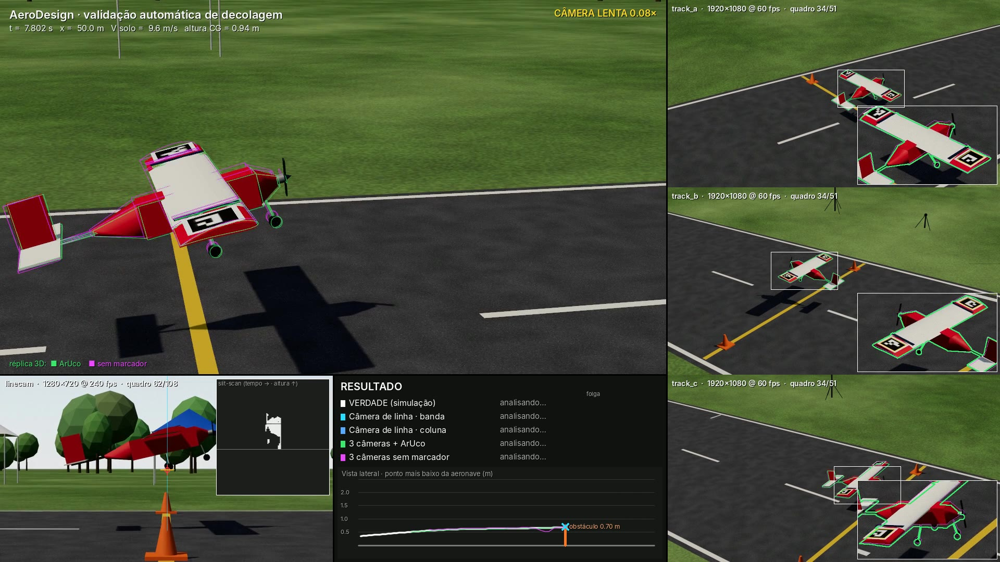

# Simulador de validação de decolagem — AeroDesign

Bancada de simulação para projetar e testar, **antes de ir a campo**, sistemas de câmeras que
decidem automaticamente se uma decolagem de AeroDesign foi válida (a aeronave passou acima do
obstáculo no fim da pista) — sem faixa física e sem bandeirinhas.

Numa única simulação de decolagem o sistema:

1. simula a corrida, rotação e subida inicial da aeronave (com vento e rajadas);
2. renderiza em 3D o que **cada câmera** veria — com resolução, FPS, exposição (motion blur),
   distorção de lente, ruído, vibração, balanço do mastro com o vento e erros de calibração;
3. entrega esses vídeos a **três algoritmos** independentes e compara o veredito de cada um com a verdade;
4. gera um **vídeo final** com a visão de todas as câmeras, os overlays dos algoritmos, uma câmera
   dinâmica seguindo a aeronave (com a réplica 3D das poses estimadas) e o painel de resultados.

| Algoritmo | Câmeras | Ideia |
|---|---|---|
| **Câmera de linha** (photo-finish) | 1 câmera rápida na altura da faixa, olhando ao longo dela | o plano do obstáculo vira uma coluna da imagem; mede o ponto mais baixo da aeronave ao cruzá-la |
| **Multi-câmera + ArUco** | 3 câmeras em mastros | detecta marcadores na asa, resolve a pose 6DoF minimizando a reprojeção em todas as câmeras |
| **Multi-câmera sem marcador** | as mesmas 3 câmeras | alinha a silhueta do modelo 3D da aeronave à silhueta observada em todas as câmeras |

Os dois métodos multi-câmera reconstroem a trajetória 3D (posição + orientação) e decidem com a
malha da aeronave: a decolagem é válida se **nenhum ponto da aeronave** cruza o plano do obstáculo
abaixo da altura da faixa.

## Como rodar

Requisitos: Node ≥ 20, Python ≥ 3.10, ffmpeg e um Chromium que o Playwright encontre.

```bash
cd aerodesign-takeoff-sim
npm install
python3 -m venv .venv && .venv/bin/pip install -r requirements.txt
npm install playwright && npx playwright install chromium   # só se ainda não houver Playwright/Chromium

./run.py scenarios/rapido.yaml        # ~10 min em CPU; gera runs/rapido/final.mp4 e report.md
./run.py scenarios/padrao.yaml        # qualidade cheia (1080p @ 120 fps nas câmeras de rastreamento)
```

Sem GPU o render roda em software (SwiftShader), a ~1 s por quadro 1080p. Numa máquina com GPU,
`SIM_GPU=1 ./run.py ...` usa a placa e fica ordens de grandeza mais rápido.

Outros modos:

```bash
./run.py scenarios/rapido.yaml --set dynamics.target_clearance_m=0.02 --name passa_2cm
./run.py scenarios/rapido.yaml --skip-render     # reaproveita os vídeos e só roda algoritmos + vídeo final
./run.py scenarios/rapido.yaml --no-video        # só resultados
tools/sweep.py scenarios/rapido.yaml --clearances=-0.10,-0.02,0.02,0.10 --seeds 1,2   # tabela de acertos
npm run ui                                       # interface interativa em http://localhost:5173
```

Cada execução cria `runs/<nome>/` com:

| Arquivo | Conteúdo |
|---|---|
| `final.mp4` | vídeo final composto (todas as câmeras + overlays + resultados) |
| `report.md`, `results.json` | veredito, folga e erro de cada algoritmo; erro de pose por quadro |
| `<camera>.mp4` | o vídeo bruto de cada câmera simulada — é isso que os algoritmos recebem |
| `scene.json` | o que os algoritmos têm direito de saber: calibração **acreditada**, malha, marcadores, obstáculo |
| `ground_truth.json` | a verdade (poses reais da aeronave e das câmeras) — usada só na avaliação |
| `chase.mp4` | câmera dinâmica com a réplica 3D das poses estimadas |

### Interface interativa

`npm run ui` abre a cena com visão livre (orbitar com o mouse), os frustums das câmeras, a prévia
ao vivo de cada câmera com todos os efeitos e um painel para mexer em vento, massa, folga-alvo,
posição/mira/FOV/FPS/exposição de cada câmera, vibração e erros de calibração. O botão
"exportar cenário" baixa um `.yaml` pronto para o `run.py` (coloque-o em `scenarios/`).
`?scenario=arquivo.yaml` na URL abre um cenário existente.

## Configuração

Tudo está em `config/default.yaml` (comentado). Um cenário sobrescreve só o que precisar e pode
herdar de outro com `extends:`. Os principais grupos:

- `runway`, `obstacle` — comprimento da pista, altura/largura do obstáculo, postes (e a altura deles),
  faixa física (opcional, embarriga com o vento), painel de contraste atrás do obstáculo.
- `environment` — sol, vento médio/direção/rajada.
- `aircraft` — geometria paramétrica (envergadura, corda, fuselagem, trem, cores…) **ou** um modelo
  `.glb` (`model: /models/meu_aviao.glb`, com `model_scale`/`model_rotation_deg`; coloque o arquivo em
  `models/`). `markers` define quantos ArUcos, de que tamanho e onde na asa (qualquer quantidade).
- `dynamics` — massa, CLmáx, tração, atrito, velocidade de rotação, ângulo de subida, desvios laterais.
  `target_clearance_m` ajusta a massa automaticamente para obter uma folga real exata — é o jeito
  de fabricar casos-limite (+2 cm, −2 cm…).
- `cameras` (+ `camera_defaults`) — para cada câmera: pose real, FOV, resolução, FPS, exposição,
  distorção, ruído, janela de gravação, `vibration` (rms de alta frequência + balanço lento do mastro
  proporcional ao vento) e `calibration_error` (diferença entre a pose real e a pose que os
  algoritmos acreditam — aleatória por σ e/ou determinística).
- `algorithms`, `output` — parâmetros dos algoritmos e do vídeo final.

Cenários prontos em `scenarios/`: `padrao`, `rapido`, `limite_passa` (+2 cm), `limite_falha` (−2 cm),
`vento_forte`, `linecam_desalinhada`, `postes_altos`, `painel_contraste`. Só `rapido` (com as folgas da
tabela abaixo) e `limite_falha` foram rodados de ponta a ponta até aqui.

## Como a simulação funciona

- **Decolagem** (`sim/src/physics.js`): modelo de 3 graus de liberdade (x, z, arfagem) com
  sustentação/arrasto/tração, atrito de rolagem, rotação em Vr, e um piloto simples que busca um
  ângulo de subida; vento de proa/través com rajadas, e desvios laterais, de rolamento e de guinada.
  Não é um simulador de voo completo — gera trajetórias plausíveis de fim de corrida.
- **Câmeras** (`sim/src/cameras.js`): pinhole + distorção radial (modelo do OpenCV); motion blur por
  acumulação de sub-quadros durante a exposição; ruído de sensor; a pose real vibra no tempo, e a
  calibração exportada para os algoritmos carrega os erros configurados.
- **Render** (`sim/src/world.js`, `aircraft.js`): three.js com céu físico, sol com sombras, materiais
  PBR e tone mapping ACES. A mesma cena roda no navegador (UI) e headless (vídeos).
- **Verdade**: a folga real é o menor `z − altura do obstáculo` entre todos os vértices da malha no
  instante em que cada um cruza o plano do obstáculo.

## Os algoritmos

Todos partem de segmentação de movimento contra o fundo (mediana temporal), com registro sub-pixel
de cada quadro ao fundo (tira a vibração), limiar maior onde o fundo tem bordas e supressão de
sombra projetada no chão (`algos/common.py`).

**Câmera de linha** (`algos/linecam.py`). Com a câmera na altura da faixa e olhando ao longo dela,
um ponto acima da faixa aparece acima dela na imagem *qualquer que seja a profundidade* — é isso que
torna o arranjo atraente. O algoritmo monta uma imagem slit-scan (tempo × altura) na coluna do plano
e pega o ponto mais baixo. Dois modos: `coluna` (photo-finish puro) e `banda` (a coluna alargada
pelo deslocamento da aeronave entre quadros, para não "pular" a roda quando o FPS é baixo). O erro
de paralaxe é ≈ `folga × (desvio lateral da aeronave / distância da câmera)`: some perto do limiar,
cresce com a folga. O que quebra essa propriedade é desalinhamento: câmera fora da altura da faixa
ou apontamento errado (ver `scenarios/linecam_desalinhada.yaml`).

**Multi-câmera + ArUco** (`algos/aruco_mv.py`). Detecção com refino sub-pixel numa região ampliada
em torno do movimento; inicialização por PnP na câmera com mais cantos; refino da pose 6DoF
minimizando o erro de reprojeção de todos os cantos em todas as câmeras (Huber).

**Multi-câmera sem marcador** (`algos/markerless.py`). Rastreador clássico por alinhamento de
silhueta com o modelo 3D, multi-vista: pontos da superfície do modelo devem projetar dentro da
silhueta observada e o contorno observado deve ficar coberto pelo modelo, em todas as câmeras ao
mesmo tempo; inicializa triangulando os centroides e rastreia com previsão de velocidade constante.

**Decisão 3D** (`algos/common.py`). As poses por quadro passam por um ajuste polinomial robusto
local (posição quadrática, orientação linear) em torno do cruzamento — isso interpola entre quadros
e tira ruído — e a folga é calculada com a malha, do mesmo jeito que a verdade.

Para testar outro algoritmo, basta escrever um módulo que leia `scene.json` + os vídeos e devolva
uma `Trajectory` (ou um veredito) e registrá-lo em `algos/evaluate.py`.

## Resultados obtidos até aqui

Condições: cenário `rapido` (câmera de linha 720p @ 240 fps a 9 m; 3 câmeras 1080p @ 60 fps, FOV 42°,
em mastros de 6 m a ~11 m do obstáculo; 2 ArUcos de 25 cm; vento de proa de 3 m/s com rajadas;
vibração de 0,01° rms + balanço do mastro; erro de calibração σ = 1 cm / 0,03° / 0,15 % de focal),
uma semente, quatro folgas reais fabricadas com `target_clearance_m`. Erro = folga estimada − folga real.

| Folga real | Verdade | Linha · banda | Linha · coluna | 3 câmeras + ArUco | 3 câmeras sem marcador |
|---|---|---|---|---|---|
| −10,0 cm | inválida | ✔ +14 mm | ✔ +14 mm | ✔ −1 mm | ✔ −1 mm |
| −2,0 cm | inválida | ✘ +20 mm | ✘ +108 mm | ✔ +2 mm | ✔ −4 mm |
| +2,1 cm | válida | ✔ +21 mm | ✔ +105 mm | ✔ 0 mm | ✔ −7 mm |
| +9,9 cm | válida | ✔ +25 mm | ✔ +25 mm | ✔ −3 mm | ✔ −8 mm |

É **uma amostra pequena (4 decolagens, 1 semente)** — serve para mostrar o que a bancada mede, não
para fechar conclusão estatística. Use `tools/sweep.py` com mais sementes e folgas.

O que apareceu:

1. **A câmera de linha herda 1:1 o erro de calibração de altura/apontamento.** O viés de ~+17 mm é
   exatamente o erro sorteado para ela nessa semente (1,4 cm na altura levantada + apontamento):
   a faixa "acreditada" fica 5,7 px fora da real. O resto do erro é paralaxe (cresce com a folga).
   Com 2 cm de margem, isso basta para inverter o veredito (linha de −2 cm).
2. **Postes da altura da faixa tapam a medição da câmera de linha.** A câmera olha ao longo da faixa
   e os postes estão nas pontas dela: com postes de 0,70 m o poste próximo escondeu o trem de pouso
   no ponto de medição e a câmera de linha leu +6 cm para folgas reais de −10 e −2 cm. Por isso o
   padrão agora são postes baixos (`obstacle.post_height_m: 0.30`); `scenarios/postes_altos.yaml`
   reproduz o problema (esse cenário não foi rodado de novo depois dos ajustes nos algoritmos).
3. **O modo `coluna` perde a roda nos casos-limite** (+105 mm): na altura da faixa o pneu escuro passa
   na frente do horizonte/árvores e a amostragem de uma única coluna não o pega. Com um painel de
   contraste atrás do obstáculo (`scenarios/painel_contraste.yaml`, só a câmera de linha testada) o modo
   coluna voltou a ver a roda (erro +18 mm, que é o viés de calibração). A explicação por contraste é
   a hipótese mais provável, coerente com esse teste, mas não foi isolada de outros fatores.
4. **ArUco multi-câmera**: pose em 49–51 de 51 quadros, erro de posição mediano ≈ 19 mm, orientação ≈ 0,6°, e erro
   de folga de poucos mm depois do ajuste de trajetória. Com 720p e FOV de 60° os marcadores de 25 cm
   **não** foram decodificados (células de ~3 px) — foi preciso 1080p com FOV de 42°. O adesivo plano
   sobre o extradorso curvo também importa: mal apoiado, a asa "fura" o marcador. E quando só **um** marcador
   é visto por **uma** câmera (fim da janela), a pose chegou a errar ~20 cm — por isso o padrão exige ≥ 8 cantos
   (`algorithms.aruco.min_corners`).
5. **Sem marcador**: pose em 47/51 quadros, erro de posição mediano ≈ 25 mm, orientação ≈ 1,5°, erro de
   folga ≤ 8 mm. Depende da segmentação: sem supressão de sombra, sem registro dos quadros (vibração)
   ou com peças na cena que não estão no modelo 3D, o erro sobe para vários centímetros.
6. **Estabilização importa para todos**: registrar cada quadro ao fundo (ignorando a região da
   aeronave) derrubou os falsos positivos de bordas do fundo que "piscam" com a vibração.

Exemplo do vídeo final (`runs/<nome>/final.mp4`):



No cruzamento do obstáculo, com as poses estimadas reprojetadas em cada câmera (verde = ArUco, magenta = sem marcador):




## Estado da arte: o que existe e o que faz sentido aqui

O problema é atípico para a literatura de pose 6D: objeto pequeno na imagem (dezenas a poucas
centenas de pixels), rápido, ao ar livre, sem profundidade, mas com **modelo 3D conhecido** e
**várias câmeras calibradas**.

**Sem marcador (modelo 3D conhecido)**

- *Rastreadores geométricos por região/contorno* — a linha RBOT → SRT3D → ICG → **M3T** (DLR). O M3T é
  uma biblioteca aberta "multi-body, multi-modality, multi-camera", roda em CPU em tempo real e é o
  candidato mais direto para substituir o baseline deste repositório
  ([DLR-RM/3DObjectTracking](https://www.github.com/DLR-RM/3DObjectTracking),
  [tese de Stoiber](https://mediatum.ub.tum.de/doc/1696259/document.pdf)). O algoritmo sem marcador
  daqui é da mesma família, numa versão simples.
- *Estimadores aprendidos para objetos novos a partir do CAD* — **FoundationPose** (NVIDIA, CVPR 2024)
  unifica estimação e rastreamento e liderou o BOP na época, mas depende de **RGB-D**
  ([artigo](https://arxiv.org/pdf/2312.08344)); **MegaPose**, **GigaPose** e **FoundPose** trabalham só
  com RGB + CAD. Numa vista só, a distância ao longo do raio é o eixo fraco — por isso a fusão
  multi-vista. Precisam de GPU.
- *Multi-vista RGB* — **CosyPose** (ECCV 2020) é a referência clássica de consistência multi-vista
  ([artigo](https://www.ecva.net/papers/eccv_2020/papers_ECCV/papers/123620562.pdf)); trabalhos
  recentes estimam translação e depois rotação a partir de várias vistas
  ([Yang et al., IJRR 2025](https://arxiv.org/html/2503.03726v2)) ou alinham features de modelos
  fundacionais entre vistas sem treinar por objeto (**AlignPose**,
  [preprint de dez/2025](https://arxiv.org/pdf/2512.20538v1)); há também filtros de partículas
  multi-câmera derivados do PoseRBPF
  ([Frontiers in Robotics and AI, 2025](https://www.frontiersin.org/journals/robotics-and-ai/articles/10.3389/frobt.2025.1683931/full)).
  O benchmark de referência é o [BOP](https://bop.felk.cvut.cz/).

**Com marcador**

- Detecção ArUco/AprilTag + otimização conjunta multi-câmera dos cantos é o que dá melhor exatidão:
  [Sarmadi et al.](https://arxiv.org/pdf/2103.09141) relatam erro sub-milimétrico e sub-grau em
  laboratório com rastreamento multi-vista de marcadores planos.
- Marcadores coplanares têm ambiguidade de pose e sofrem com reflexo; conjuntos de marcadores em
  planos diferentes ajudam ([AprilTags 3D](https://arxiv.org/pdf/2001.08622)).

**Leitura para este projeto**

- ArUco multi-câmera é o caminho mais simples e mais exato, mas exige adesivo em toda aeronave, no
  extradorso — logo, câmeras altas — e marcador grande o bastante na imagem (ver achados acima).
- Sem marcador funciona só com o 3D da aeronave, mas depende da qualidade da segmentação (sombras,
  fundo, vibração) e da fidelidade do modelo (asa que flete, carga, trem).
- Os métodos aprendidos (MegaPose/FoundPose/AlignPose) entram melhor como inicialização/robustez
  sobre o refino geométrico multi-vista do que como substitutos; não foram rodados aqui (exigem GPU e
  pesos que este ambiente não baixa).

## Premissas a conferir e limitações

- **Regulamento**: o site da SAE Brasil não estava acessível deste ambiente. Pista de 50 m veio do
  briefing; **altura do obstáculo (0,70 m), largura entre postes (6 m) e largura da pista (8 m) são
  chutes configuráveis** — ajustar em `config/default.yaml`.
- **Aeronave**: massa, área, CLmáx, tração e as velocidades resultantes (estol ≈ 10–11 m/s, cruzando o
  obstáculo a ≈ 9–10 m/s de velocidade de solo com 3 m/s de vento de proa) são valores típicos de
  memória para a classe Regular, não tirados de relatórios de equipes. Trocar pelos números reais.
- **Não simulado ainda**: rolling shutter, dessincronismo entre câmeras (assume-se gatilho comum),
  variação de exposição/auto-ganho, chuva/poeira, pessoas e objetos se movendo no fundo, flexão da
  asa, e o **procedimento de calibração em si** (o erro de calibração é imposto, não resultado de
  um processo com pontos de controle).
- **Realismo visual**: iluminação e sombras são fisicamente razoáveis, mas vegetação e cenário são
  estilizados; o fundo real é mais difícil para segmentação por movimento do que este.
- O carregamento de aeronave `.glb` está implementado, mas **não foi testado** com um modelo real.
- O algoritmo sem marcador é um baseline clássico; os métodos de ponta listados acima não foram
  integrados.
