# AeroDesign Takeoff Detection Simulator

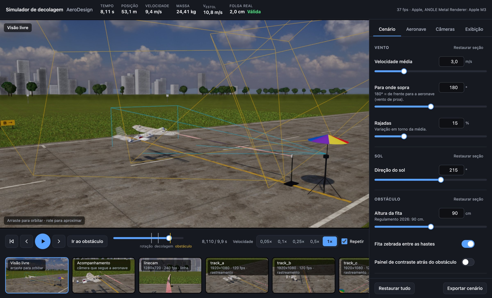

Bancada de simulação para projetar e testar, **antes de ir a campo**, sistemas de câmeras que
decidem automaticamente se uma decolagem do SAE BRASIL AeroDesign foi válida — se a aeronave passou
acima da fita de 90 cm no fim da corrida — sem fita física e sem fiscais de bandeirinha.

Numa única simulação de decolagem o sistema:

1. simula a corrida, a rotação e a subida inicial da aeronave, com vento e rajadas;
2. renderiza em 3D o que **cada câmera** veria — com resolução, quadros/s, exposição (borrão de movimento),
   distorção de lente, ruído, vibração, balanço do mastro com o vento e erros de calibração;
3. entrega esses vídeos a **três algoritmos** independentes e compara o veredito de cada um com a verdade;
4. gera um **vídeo final** com todas as câmeras, os overlays dos algoritmos, uma câmera que segue a
   aeronave (com a réplica 3D das poses estimadas) e o painel de resultados.

📄 **[Relatório completo (PDF)](docs/relatorio_simulador_decolagem.pdf)** — método, imagens de cada etapa,
resultados e recomendações.

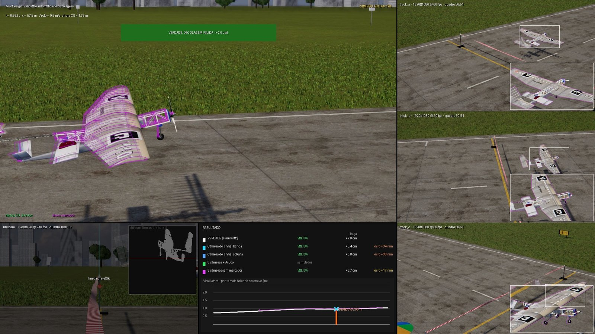

## O cenário

A cena reproduz o local da competição em São José dos Campos a partir de fotos da transmissão: pista de
concreto com juntas entre placas, campo aberto, instrumentos e torre de antena do aeroporto, capões de árvores
e os prédios da cidade no horizonte. O céu e a luz vêm de uma imagem HDR real; concreto e grama são texturas
escaneadas. Roda em tempo real no navegador (three.js/WebGL) — ~60 quadros/s numa câmera 1080p num Apple M3.

<table>
<tr>
<td width="50%">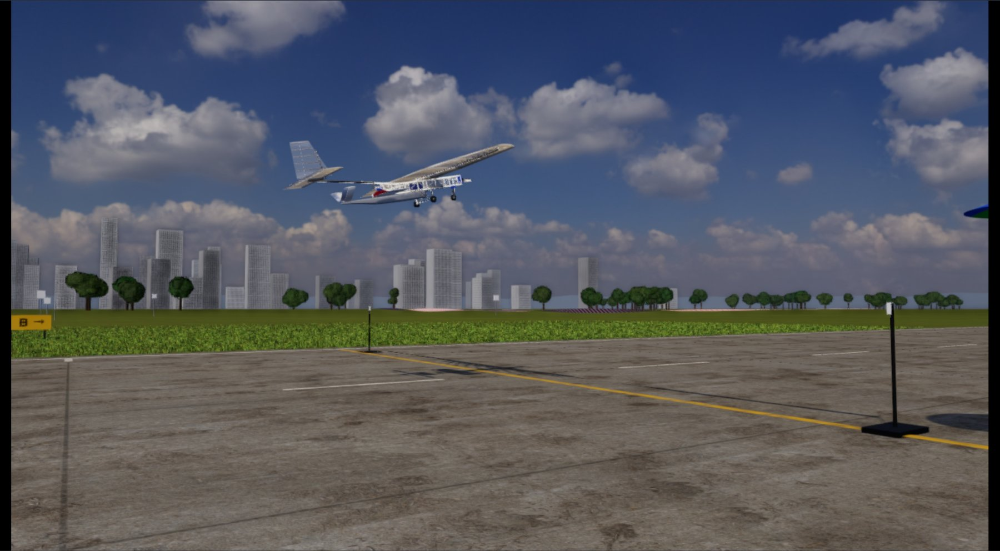</td>
<td width="50%">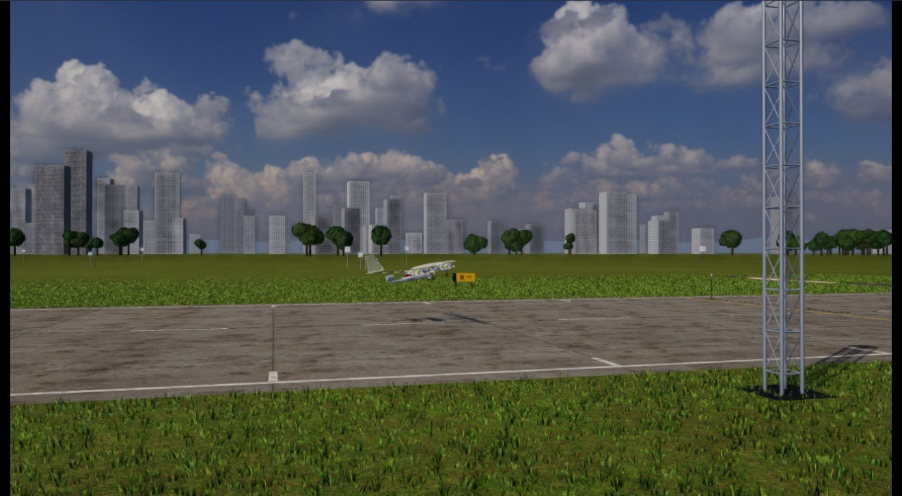</td>
</tr>
<tr>
<td>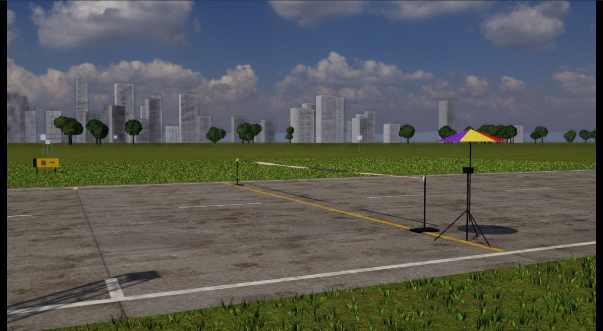</td>
<td>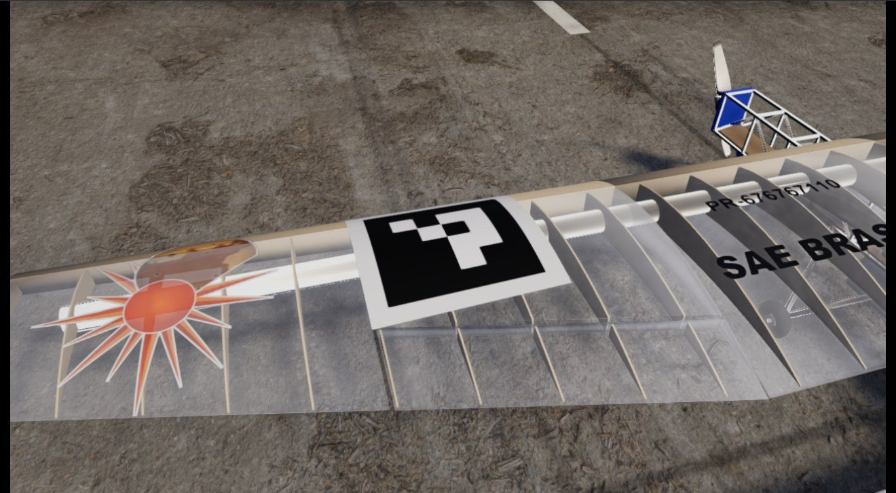</td>
</tr>
<tr>
<td>Obstáculo do regulamento 2026 e a câmera de linha num tripé com guarda-sol, como a câmera de teste de 2026.</td>
<td>Adesivo ArUco colado na asa, acompanhando a curvatura do perfil.</td>
</tr>
</table>

- **Obstáculo** (Regulamento 2026 Rev01, R[7.8.0.1]/R[8.11.0.1]): fita de **90 cm** de altura e **10 m** de
  largura a **55 m** da largada, com as marcas auxiliares na pista. Hastes de tubo preto sobre base pesada,
  com o prendedor branco no topo; a fita vermelha e branca torce ao longo do vão, cai no meio e embarriga com
  o vento.
- **Aeronave**: o modelo 3D de uma equipe da classe Advanced (`models/drone_advanced.blend`), com treliça de
  alumínio, asa entelada com filme transparente e adesivos. Dois ArUcos de 25 cm colados no extradorso.
- **Câmeras**: quatro, todas do mesmo lado da pista. A de linha num tripé ao lado da haste, no plano da fita;
  as três de rastreamento em torres de treliça de alumínio, como as da competição.

## Os algoritmos e o que eles enxergam

| Algoritmo | Câmeras | Ideia |
|---|---|---|
| **Câmera de linha** (photo-finish) | 1 câmera rápida no plano da fita, olhando ao longo dela | o plano do obstáculo vira uma coluna da imagem; mede o ponto mais baixo da aeronave ao cruzá-la |
| **3 câmeras + ArUco** | 3 câmeras nas torres | detecta os marcadores na asa e resolve a pose 6DoF minimizando a reprojeção em todas as câmeras |
| **3 câmeras sem marcador** | as mesmas 3 câmeras | encaixa a silhueta do modelo 3D da aeronave nas silhuetas observadas em todas as câmeras |

Todos começam separando o que se move do fundo. As imagens abaixo são as etapas intermediárias reais de
uma simulação com folga real de +2 cm, no instante em que a aeronave cruza o obstáculo
(`tools/report_figures.py` gera todas a partir de um `runs/<nome>/`).

**Câmera de linha** — quadro, diferença ao fundo e máscara com a coluna de medição (azul), a altura da fita
(vermelho) e o ponto mais baixo medido (círculo):

<table>
<tr>
<td>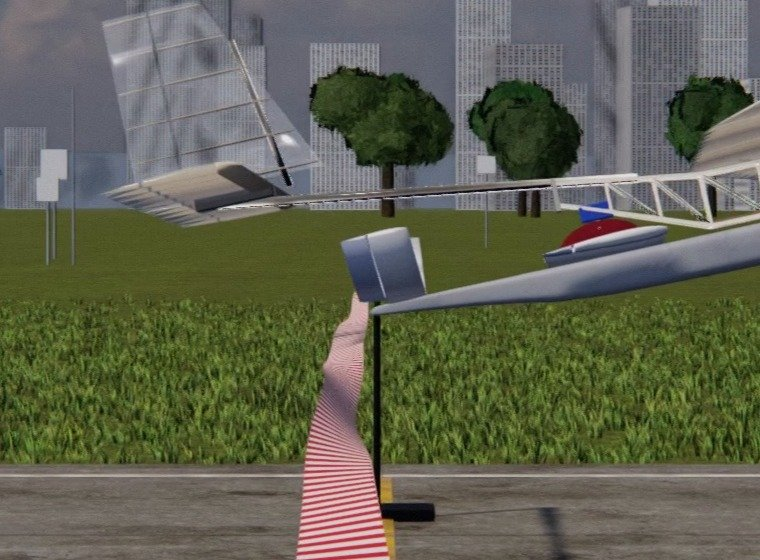</td>
<td>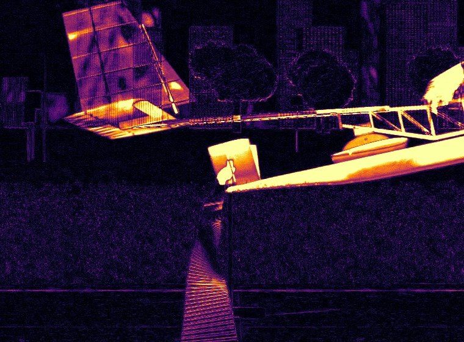</td>
<td>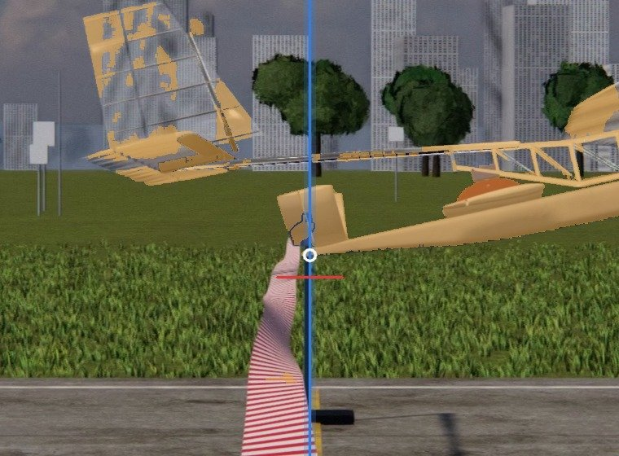</td>
</tr>
</table>

Empilhando a coluna de todos os quadros sai uma imagem tempo × altura (*slit-scan*); o ponto mais baixo é a
medida — aqui 95,4 cm, contra 92,0 cm reais:

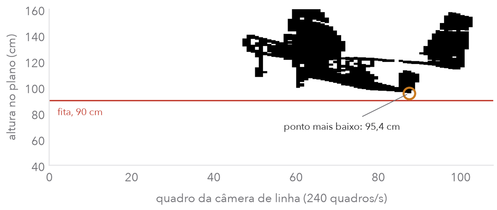

**Sem marcador** — à esquerda, a máscara da aeronave (âmbar) e a sombra reconhecida e descartada (azul); à
direita, o encaixe do modelo: silhueta observada em âmbar, modelo na pose estimada em azul e na pose real
em verde:

<table>
<tr>
<td width="50%">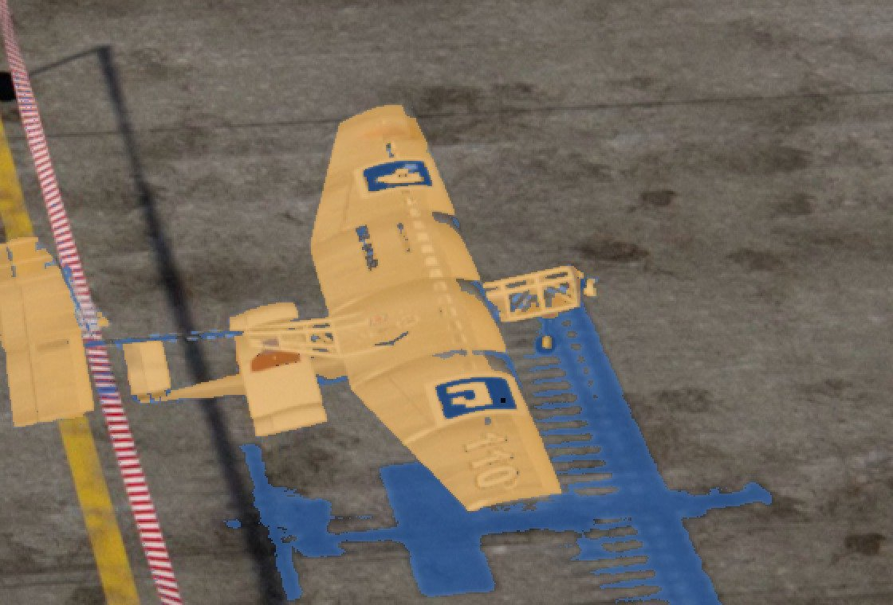</td>
<td width="50%">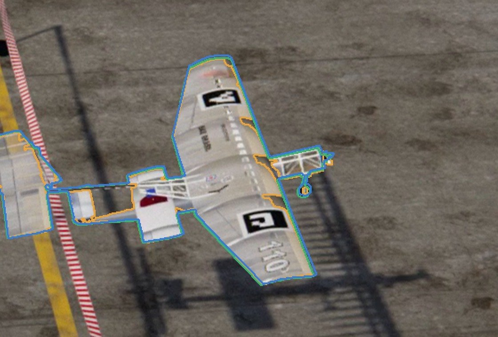</td>
</tr>
</table>

**ArUco** — o melhor caso de toda a simulação (~40 px de lado): recorte, binarização e os quadriláteros
que o detector encontrou e rejeitou (vermelho), com os cantos verdadeiros (verde). A borda preta está lá,
mas a curvatura da asa desloca os cantos e a grade de bits lida não bate com nenhum código:

<table>
<tr>
<td>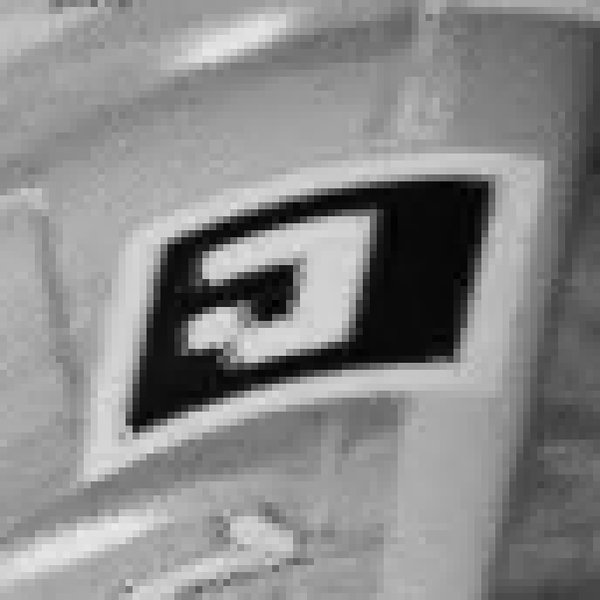</td>
<td>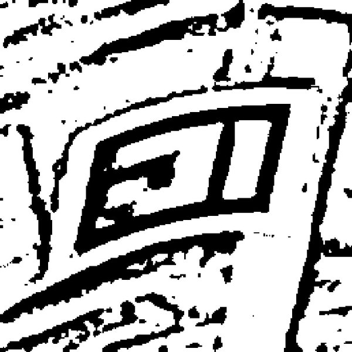</td>
<td>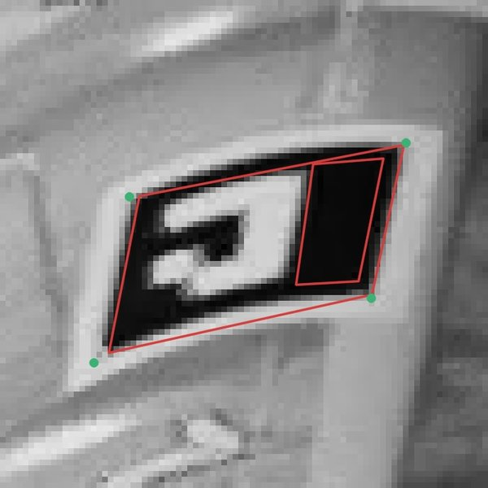</td>
</tr>
</table>

Os dois métodos multi-câmera reconstroem a trajetória 3D (posição e orientação) e decidem com a malha da
aeronave: a decolagem é válida se **nenhum ponto da aeronave** cruza o plano do obstáculo abaixo da fita.

## Resultados

Quatro decolagens no limite, uma semente cada, no cenário atual (obstáculo 2026, quatro câmeras do mesmo
lado). Erro = folga medida − folga real.

| Simulação | Folga real | Linha · banda | Linha · coluna | 3 câmeras + ArUco | 3 câmeras sem marcador |
|---|---|---|---|---|---|
| Cenário final (obstáculo, fita e tripé como nas fotos) | +2,0 cm | ✔ +34 mm | ✔ +38 mm | sem dados | ✔ +17 mm |
| Obstáculo 2026 (fita deitada, câmera de linha mais longe) | +2,0 cm | ✔ +46 mm | ✔ +52 mm | sem dados | ✔ +17 mm |
| Uma câmera do outro lado da pista (pista de 50 m, fita a 70 cm) | +2,1 cm | ✔ +31 mm | ✔ +37 mm | sem dados | ✔ +4 mm |
| Decolagem inválida (cenário final) | −3,0 cm | ✔ +26 mm | ✔ +30 mm | sem dados | ✔ +18 mm |

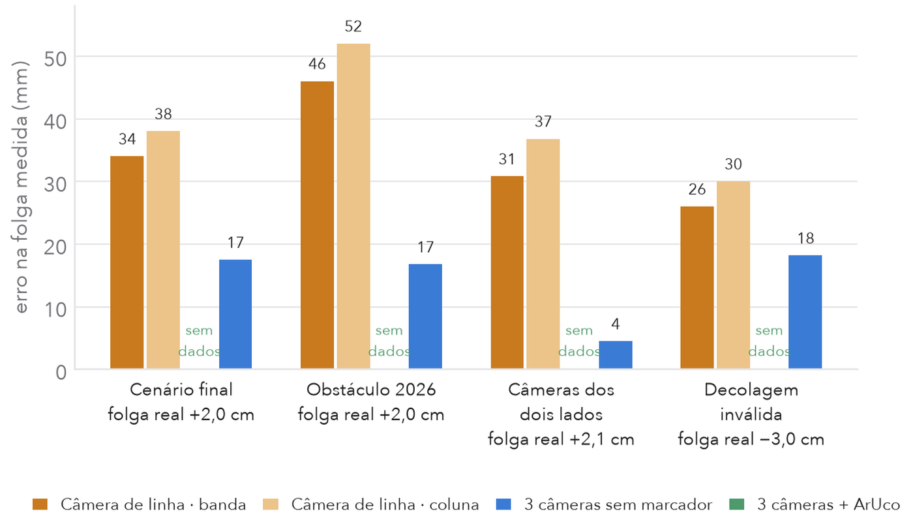

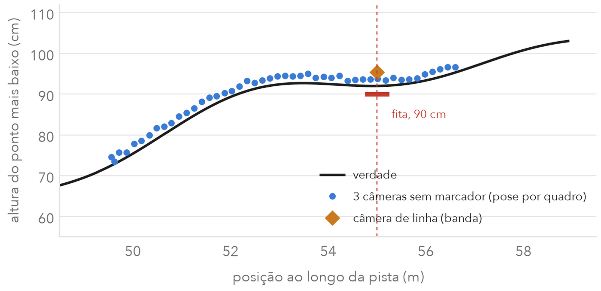

O que apareceu:

1. **O rastreamento sem marcador foi o mais preciso**: erro de folga de 4 a 18 mm e veredito certo em todos
   os casos. A pose saiu em 44–47 de 51 quadros, com erro de posição mediano de 15 mm com uma câmera do
   outro lado da pista e de ~40 mm com todas do mesmo lado — **a geometria das câmeras importa**.
2. **A câmera de linha superestima a folga em 3 a 5 cm.** Acertou os vereditos, mas na decolagem inválida
   mediu −0,4 cm para −3,0 cm reais: ficou a 4 mm de aprovar uma decolagem que bateu na fita. As causas:
   - o erro de calibração de altura e apontamento entra 1:1 na medida (numa semente, 1,4 cm na altura da
     câmera deslocou a fita "acreditada" 5,7 px, ~17 mm);
   - paralaxe quando a aeronave não passa no eixo da pista;
   - a haste e a fita torcida ficam bem na frente da coluna de medição (por isso a câmera fica 25 cm acima
     da fita) e podem esconder uma roda que passe logo abaixo;
   - no modo `coluna`, o pneu escuro na frente da grama e das árvores some na segmentação; um painel de
     contraste atrás do obstáculo (`scenarios/painel_contraste.yaml`) resolveu nos testes.
3. **ArUco colado na asa não funcionou.** Um marcador de 25 cm — o mínimo para decodificar a ~11 m em 1080p
   com 42° de campo — cobre metade da corda desta asa, e o extradorso sobe ~50 mm debaixo dele. O detector do
   OpenCV supõe um marcador plano: acha o quadrado preto, mas os cantos saem ~1 px fora e a leitura dos bits
   falha (os bits são legíveis quando amostrados nos cantos verdadeiros). Também não funcionaram: 15–20 cm, a
   parte mais plana da asa, margem branca maior, acabamento fosco e os refinamentos *contour* e *AprilTag* —
   no máximo 2 de 6 detecções, contra 4–6 do mesmo marcador plano.
4. **Estabilização e sombras importam para todos**: registrar cada quadro ao fundo (tira a vibração) e
   descartar a sombra projetada derrubaram o erro do sem marcador de vários centímetros para milímetros.

<details>
<summary>Versão anterior, com o ArUco como placa plana (pista de 50 m, fita a 70 cm)</summary>

| Folga real | Linha · banda | Linha · coluna | 3 câmeras + ArUco | 3 câmeras sem marcador |
|---|---|---|---|---|
| −10,0 cm | ✔ +14 mm | ✔ +14 mm | ✔ −1 mm | ✔ −1 mm |
| −2,0 cm | ✘ +20 mm | ✘ +108 mm | ✔ +2 mm | ✔ −4 mm |
| +2,1 cm | ✔ +21 mm | ✔ +105 mm | ✔ 0 mm | ✔ −7 mm |
| +9,9 cm | ✔ +25 mm | ✔ +25 mm | ✔ −3 mm | ✔ −8 mm |

Com marcador plano, o ArUco foi o mais preciso (pose em 49–51 de 51 quadros, erro de posição ≈ 19 mm). Com
um único marcador visto por uma única câmera a pose chegou a errar ~20 cm — por isso o padrão exige ≥ 8
cantos (`algorithms.aruco.min_corners`).

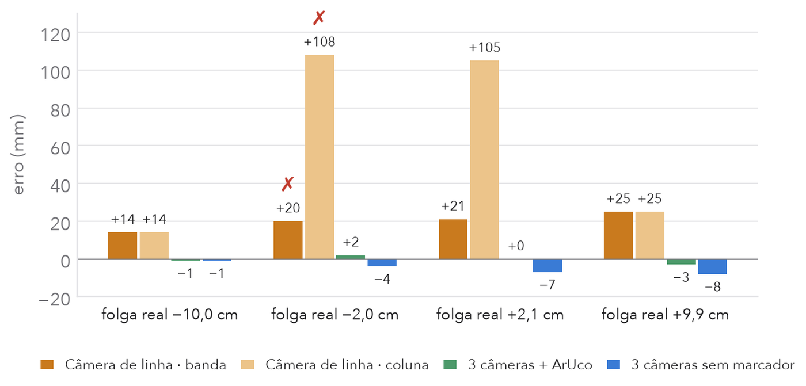
</details>

São **amostras pequenas** — uma semente por caso. Servem para mostrar o que a bancada mede e onde estão os
riscos, não para fechar conclusão estatística; use `tools/sweep.py` com mais sementes e folgas.

## Como rodar

Requisitos: Node ≥ 20, Python ≥ 3.10, ffmpeg e um Chromium que o Playwright encontre.

```bash
git clone https://github.com/rafaellehmkuhl/Aerodesign-Takeoff-Detection-Simulator
cd Aerodesign-Takeoff-Detection-Simulator
npm install
python3 -m venv .venv && .venv/bin/pip install -r requirements.txt
python3 tools/fetch_assets.py          # ~60 MB de assets CC0 do Poly Haven (céu HDRI, concreto, asfalto, grama, folhagem)
# o render headless usa o Chromium do Playwright (npx playwright install chromium) ou, sem ele, o Chrome instalado

npm run ui                             # interface interativa em http://127.0.0.1:5173
SIM_GPU=1 ./run.py scenarios/limite_passa.yaml   # simulação completa com GPU: 4–8 min; gera runs/limite_passa/
```

Sem GPU o render roda em software (SwiftShader), a ~3–5 s por quadro 1080p no cenário realista
(~1 s no cenário `basic`); `./run.py scenarios/rapido.yaml` é a opção mais leve. Com `SIM_GPU=1` o render usa
a placa de vídeo (Metal no macOS) e fica ordens de grandeza mais rápido.

Outros modos:

```bash
./run.py scenarios/rapido.yaml --set dynamics.target_clearance_m=0.02 --name passa_2cm
./run.py scenarios/rapido.yaml --skip-render     # reaproveita os vídeos e só roda algoritmos + vídeo final
./run.py scenarios/rapido.yaml --no-video        # só resultados
tools/sweep.py scenarios/rapido.yaml --clearances=-0.10,-0.02,0.02,0.10 --seeds 1,2   # tabela de acertos
.venv/bin/python tools/report_figures.py runs/<nome> saida/   # imagens intermediárias dos algoritmos
```

Cada execução cria `runs/<nome>/` com:

| Arquivo | Conteúdo |
|---|---|
| `final.mp4` | vídeo final composto (todas as câmeras + overlays + resultados) |
| `report.md`, `results.json` | veredito, folga e erro de cada algoritmo; erro de pose por quadro |
| `<camera>.mp4` | o vídeo bruto de cada câmera simulada — é isso que os algoritmos recebem |
| `scene.json` | o que os algoritmos têm direito de saber: calibração **acreditada**, malha, marcadores, obstáculo |
| `ground_truth.json` | a verdade (poses reais da aeronave e das câmeras) — usada só na avaliação |
| `chase.mp4` | câmera que segue a aeronave, com a réplica 3D das poses estimadas |

### Interface interativa

`npm run ui` e abra `http://127.0.0.1:5173`. A tela tem:

- **a imagem da câmera escolhida** (visão livre orbitável, câmera de acompanhamento ou qualquer câmera do
  cenário, com todos os efeitos) e, embaixo, **miniaturas ao vivo** de todas elas — clique para trocar;
- **um player fixo**: tocar/pausar, quadro anterior/próximo, ir ao obstáculo, linha do tempo com as marcas
  de rotação, decolagem e obstáculo, velocidade de 0,05× a 1× e repetir. Atalhos: Espaço, ←/→ (um quadro
  de 1/240 s; com Shift, 0,1 s), Home e O;
- **um painel em abas** (Cenário, Aeronave, Câmeras, Exibição) com controles grandes, valores digitáveis e
  unidades. Cada valor alterado fica destacado e ganha um botão para voltar ao padrão; cada seção tem
  "Restaurar seção" e o rodapé tem "Restaurar tudo" e "Exportar cenário" (um `.yaml` pronto para o
  `run.py`; coloque-o em `scenarios/`).

`?scenario=arquivo.yaml` na URL abre um cenário existente. O canto superior direito mostra o fps e a GPU
em uso — se aparecer "render por software", o navegador não está usando a placa de vídeo.

### Controle externo (API e MCP)

O servidor da interface também expõe uma **API HTTP** (`/api`) e um **servidor MCP** (`/mcp`, ou `npm run mcp`
por stdio) para agentes e outras aplicações. Eles alteram qualquer parâmetro do cenário (com validação),
controlam a reprodução e a câmera da interface aberta, renderizam quadros, disparam simulações completas e
leem os resultados. A interface e os agentes compartilham a mesma sessão: o que um muda, o outro vê.
Detalhes e exemplos em [docs/API.md](docs/API.md); o `.mcp.json` da raiz já registra o servidor no Claude Code.

## Configuração

Tudo está em `config/default.yaml` (comentado). Um cenário sobrescreve só o que precisar e pode
herdar de outro com `extends:`. Os principais grupos:

- `runway`, `obstacle` — pista e obstáculo, com os padrões do regulamento 2026 descritos acima. A fita física
  fica ligada por padrão (`obstacle.tape`), cai `tape_sag_m` no meio do vão, torce `tape_twist_deg` e
  embarriga com o vento; a validação mede contra o plano do obstáculo na altura nominal. Painel de contraste
  opcional.
- `environment` — sol, vento médio/direção/rajada, qualidade da cena (`real` ou `basic`), pavimento
  (`concreto` ou `asfalto`) e névoa. A grama fica parada por padrão (`grass_wind`); as árvores balançam com o vento.
- `aircraft` — geometria paramétrica (envergadura, corda, fuselagem, trem, cores…) **ou** um modelo
  `.glb` (`model: /models/meu_aviao.glb`, com `model_scale`/`model_rotation_deg`; coloque o arquivo em
  `models/`). `markers` define quantos ArUcos, de que tamanho e onde na asa;
  `markers_enabled: false` (ou a chave "adesivos ArUco" na interface) tira todos, para comparar com e sem.
  Cada adesivo é uma malha colada no envelope externo da asa que acompanha a curvatura do perfil, com o
  comprimento medido ao longo da superfície (como um vinil esticado, que passa reto por cima de degraus).
  Os cantos usados pelo algoritmo são os pontos reais do marcador sobre a superfície curva.
- `dynamics` — massa, CLmáx, tração, atrito, velocidade de rotação, ângulo de subida, desvios laterais.
  `target_clearance_m` ajusta a massa automaticamente para obter uma folga real exata — é o jeito
  de fabricar casos-limite (+2 cm, −2 cm…).
- `cameras` (+ `camera_defaults`) — para cada câmera: pose real, FOV, resolução, quadros/s, exposição,
  distorção, ruído, janela de gravação, `vibration` (rms de alta frequência + balanço lento do mastro
  proporcional ao vento), `calibration_error` (diferença entre a pose real e a que os algoritmos
  acreditam — aleatória por σ e/ou determinística) e os efeitos de imagem (FXAA, oclusão de ambiente,
  bloom, aberração cromática, vinheta).
- `algorithms`, `output` — parâmetros dos algoritmos e do vídeo final.

Cenários prontos em `scenarios/`: `padrao`, `rapido`, `limite_passa` (+2 cm), `limite_falha` (−2 cm),
`vento_forte`, `linecam_desalinhada`, `painel_contraste`, `regular_parametrica` (aeronave paramétrica da
classe Regular).

### Usar outra aeronave

A aeronave padrão é `models/drone_advanced.glb`, exportada de `models/drone_advanced.blend`. Para outra:

```bash
pip install bpy                                             # num ambiente separado (~1 GB)
python tools/blend_to_glb.py models/minha.blend models/minha.glb
```

e, no cenário, `aircraft.model: /models/minha.glb`, `model_origin_m` (posição do CG no modelo, com as rodas
em z = 0) e as dimensões usadas pela física (`wingspan_m`, `chord_m`, `gear_height_m`, `main_gear_x_m`,
`tail_arm_m`). Objetos chamados `Helice…` giram; o material `Film` vira filme transparente; objetos
`Adesivo…` não entram na malha de colisão/silhueta.

## Como a simulação funciona

- **Decolagem** (`sim/src/physics.js`): modelo de 3 graus de liberdade (x, z, arfagem) com
  sustentação/arrasto/tração, atrito de rolagem, rotação em Vr e um piloto simples que busca um
  ângulo de subida; vento de proa/través com rajadas, e desvios laterais, de rolamento e de guinada.
  Não é um simulador de voo completo — gera trajetórias plausíveis de fim de corrida.
- **Câmeras** (`sim/src/cameras.js`): pinhole + distorção radial (modelo do OpenCV); borrão de movimento por
  acumulação de sub-quadros durante a exposição; ruído de sensor; a pose real vibra no tempo, e a
  calibração exportada para os algoritmos carrega os erros configurados.
- **Render** (`sim/src/world_real.js`, `world.js`, `aircraft.js`): three.js com iluminação por HDRI, sol com
  sombras, materiais PBR, oclusão de ambiente e tone mapping ACES. A mesma cena roda no navegador (interface)
  e headless (vídeos).
- **Verdade**: a folga real é o menor `z − altura do obstáculo` entre todos os pontos da aeronave no
  instante em que cada um cruza o plano do obstáculo.

## Os algoritmos em detalhe

Todos partem de segmentação de movimento contra o fundo (mediana temporal), com registro sub-pixel
de cada quadro ao fundo (tira a vibração), limiar maior onde o fundo tem bordas e supressão de
sombra projetada no chão (`algos/common.py`).

**Câmera de linha** (`algos/linecam.py`). Com a câmera no plano da fita e olhando ao longo dela,
um ponto acima da fita aparece acima dela na imagem *qualquer que seja a profundidade* — é isso que
torna o arranjo atraente. O algoritmo monta a imagem slit-scan na coluna do plano e pega o ponto mais
baixo. Dois modos: `coluna` (photo-finish puro) e `banda` (a coluna alargada pelo deslocamento da aeronave
entre quadros, para não "pular" a roda quando a taxa de quadros é baixa). O erro de paralaxe é
≈ `folga × (desvio lateral da aeronave / distância da câmera)`: some perto do limiar e cresce com a folga.
O que quebra a propriedade é desalinhamento: câmera fora do plano da fita ou apontamento errado
(`scenarios/linecam_desalinhada.yaml`).

**3 câmeras + ArUco** (`algos/aruco_mv.py`). Detecção com refino sub-pixel numa região ampliada
em torno do movimento; inicialização por PnP na câmera com mais cantos; refino da pose 6DoF
minimizando o erro de reprojeção de todos os cantos em todas as câmeras (Huber).

**3 câmeras sem marcador** (`algos/markerless.py`). Rastreador clássico por alinhamento de
silhueta com o modelo 3D, multi-vista: pontos da superfície do modelo devem projetar dentro da
silhueta observada e o contorno observado deve ficar coberto pelo modelo, em todas as câmeras ao
mesmo tempo; inicializa triangulando os centroides e rastreia com previsão de velocidade constante.

**Decisão 3D** (`algos/common.py`). As poses por quadro passam por um ajuste polinomial robusto
local (posição quadrática, orientação linear) em torno do cruzamento — isso interpola entre quadros
e tira ruído — e a folga é calculada com a malha, do mesmo jeito que a verdade.

Para testar outro algoritmo, basta escrever um módulo que leia `scene.json` + os vídeos e devolva
uma `Trajectory` (ou um veredito) e registrá-lo em `algos/evaluate.py`.

## Estado da arte: o que existe e o que faz sentido aqui

O problema é atípico para a literatura de pose 6D: objeto pequeno na imagem (dezenas a poucas
centenas de pixels), rápido, ao ar livre, sem profundidade, mas com **modelo 3D conhecido** e
**várias câmeras calibradas**.

**Sem marcador (modelo 3D conhecido)**

- *Rastreadores geométricos por região/contorno* — a linha RBOT → SRT3D → ICG → **M3T** (DLR). O M3T é
  uma biblioteca aberta "multi-body, multi-modality, multi-camera", roda em CPU em tempo real e é o
  candidato mais direto para substituir o baseline deste repositório
  ([DLR-RM/3DObjectTracking](https://www.github.com/DLR-RM/3DObjectTracking),
  [tese de Stoiber](https://mediatum.ub.tum.de/doc/1696259/document.pdf)). O algoritmo sem marcador
  daqui é da mesma família, numa versão simples.
- *Estimadores aprendidos para objetos novos a partir do CAD* — **FoundationPose** (NVIDIA, CVPR 2024)
  unifica estimação e rastreamento e liderou o BOP na época, mas depende de **RGB-D**
  ([artigo](https://arxiv.org/pdf/2312.08344)); **MegaPose**, **GigaPose** e **FoundPose** trabalham só
  com RGB + CAD. Numa vista só, a distância ao longo do raio é o eixo fraco — por isso a fusão
  multi-vista. Precisam de GPU.
- *Multi-vista RGB* — **CosyPose** (ECCV 2020) é a referência clássica de consistência multi-vista
  ([artigo](https://www.ecva.net/papers/eccv_2020/papers_ECCV/papers/123620562.pdf)); trabalhos
  recentes estimam translação e depois rotação a partir de várias vistas
  ([Yang et al., IJRR 2025](https://arxiv.org/html/2503.03726v2)) ou alinham features de modelos
  fundacionais entre vistas sem treinar por objeto (**AlignPose**,
  [preprint de dez/2025](https://arxiv.org/pdf/2512.20538v1)); há também filtros de partículas
  multi-câmera derivados do PoseRBPF
  ([Frontiers in Robotics and AI, 2025](https://www.frontiersin.org/journals/robotics-and-ai/articles/10.3389/frobt.2025.1683931/full)).
  O benchmark de referência é o [BOP](https://bop.felk.cvut.cz/).

**Com marcador**

- Detecção ArUco/AprilTag + otimização conjunta multi-câmera dos cantos é o que dá melhor exatidão com
  marcadores planos: [Sarmadi et al.](https://arxiv.org/pdf/2103.09141) relatam erro sub-milimétrico e
  sub-grau em laboratório.
- Marcadores coplanares têm ambiguidade de pose e sofrem com reflexo; conjuntos de marcadores em
  planos diferentes ajudam ([AprilTags 3D](https://arxiv.org/pdf/2001.08622)).

**Leitura para este projeto**

- O ArUco multi-câmera seria o caminho mais exato, mas exige marcador plano e grande o bastante na imagem;
  colado no extradorso curvo desta asa, a ~11 m, ele não é detectado (ver resultados).
- Sem marcador funciona só com o 3D da aeronave, que as equipes já têm, mas depende da qualidade da
  segmentação (sombras, fundo, vibração), da geometria das câmeras e da fidelidade do modelo (asa que
  flete, carga, trem).
- Os métodos aprendidos (MegaPose/FoundPose/AlignPose) entram melhor como inicialização/robustez
  sobre o refino geométrico multi-vista do que como substitutos; não foram rodados aqui.

## Premissas a conferir e limitações

- **Regulamento**: altura, largura e distância do obstáculo vêm do regulamento 2026 Rev01. A largura da
  pista (14 m), a flecha e a torção da fita e as dimensões das hastes e bases são estimativas a partir de fotos.
- **Aeronave**: a geometria é a do modelo fornecido, mas massa, CLmáx, tração, posição do CG e as
  velocidades resultantes (estol ≈ 10–11 m/s, cruzando o obstáculo a ≈ 9–10 m/s de velocidade de solo com
  3 m/s de vento de proa) são estimativas, não dados da equipe. A posição dos ArUcos na asa também.
- **Não simulado ainda**: obturador rolante, câmeras fora de sincronia (assume-se gatilho comum),
  exposição/ganho automáticos, chuva/poeira, pessoas e veículos no fundo, flexão da asa e o
  **procedimento de calibração em si** (o erro de calibração é imposto, não resultado de um processo com
  pontos de controle).
- **Realismo visual**: céu, luz, concreto e grama vêm de material escaneado e a aeronave é o modelo real,
  mas é rasterização em tempo real, não path tracing: sem iluminação global nem reflexos reais; árvores,
  prédios, instrumentos do aeroporto e torres são procedurais.
- O algoritmo sem marcador é um baseline clássico; os métodos de ponta listados acima não foram integrados.
